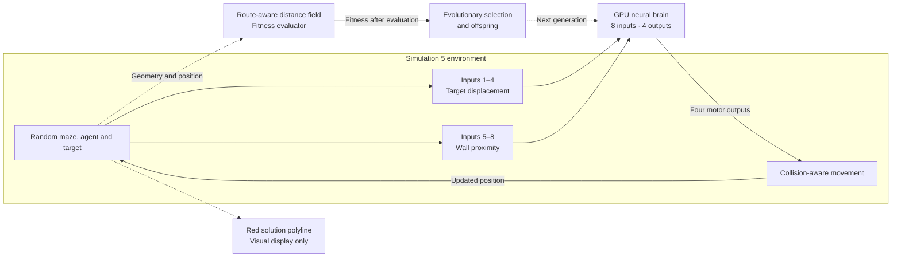
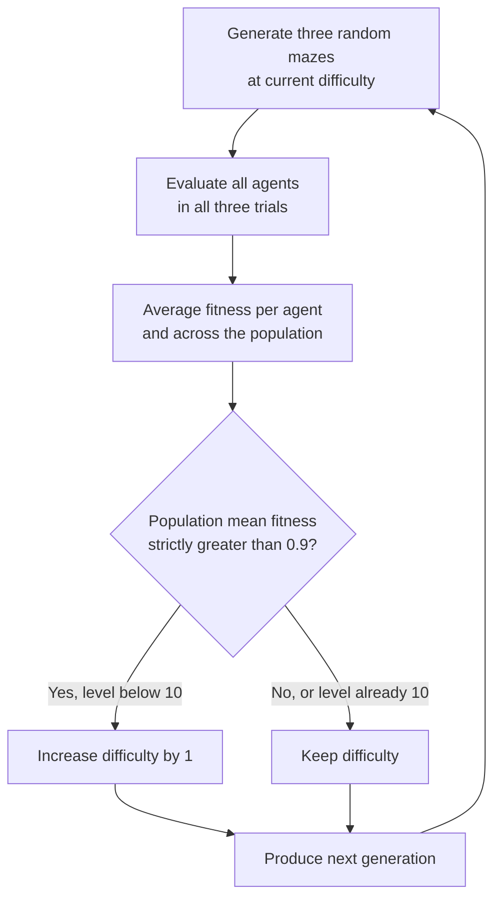

# Neurons GPU

**Evolving neural agents in 2D navigation environments with Godot and GPU compute shaders.**

Neurons GPU evaluates populations of neural agents in **five evolutionary navigation experiments**, progressing from target pursuit to procedurally generated mazes. The neural networks are built and executed on the GPU; GDScript handles environments, sensors, actuators, collisions, fitness, and evolutionary scheduling.

> [!IMPORTANT]
> **Fitness is not a neural input.** The agents receive sensory signals, not reward values, route coordinates, or the distance field used by the evaluator. The **red maze solution** is a visualization for the researcher only.

## Contents

- [Quick start](#quick-start)
- [Experiments](#experiments)
- [Neural inputs and outputs](#neural-inputs-and-outputs)
- [Simulation 5: procedural mazes](#simulation-5-procedural-mazes)
  - [Maze construction and visual solution](#maze-construction-and-visual-solution)
  - [Directional wall sensors](#directional-wall-sensors)
  - [Fitness and evaluation](#fitness-and-evaluation)
  - [Difficulty curriculum](#difficulty-curriculum)
  - [What the results do and do not demonstrate](#what-the-results-do-and-do-not-demonstrate)
- [Evolution and interface controls](#evolution-and-interface-controls)
- [Persistence and compatibility](#persistence-and-compatibility)
- [Project structure](#project-structure)

## Quick start

1. Open `project.godot` in **Godot 4.7** with a compute-capable rendering device.
2. Run [`scenes/simulations.tscn`](scenes/simulations.tscn).
3. Choose **Simulation 1–5** and configure `I × J × K` brain dimensions, connection density `η`, generation duration, mutation probability, and population size.
4. Press **Start**. Use **Pause**, the evolution/diversity graphs, the genetic heatmap, and individual-agent inspection to examine the run.

Every environment/neural update represents **1/60 simulated second**. The configured trial duration limits how long an agent can act; how fitness uses that period depends on the experiment.

## Experiments

| Experiment | Evolutionary task | Trials per generation | Neural I/O |
|:---:|---|:---:|:---:|
| **1** | Reach a stationary, randomly relocated target | 3 | 4 → 4 |
| **2** | Chase a target that teleports every 5 simulated seconds | 3 | 4 → 4 |
| **3** | Pursue a target moving between random waypoints at half agent speed | 3 | 4 → 4 |
| **4** | Navigate around a solid, rotated obstacle with an angular-sector curriculum | 3–12 | 5 → 4 |
| **5** | Navigate procedurally generated mazes using local wall-distance sensors | 3 | **8 → 4** |

<details>
<summary><strong>Fitness definitions and curriculum for Simulations 1–4</strong></summary>

### Simulations 1–3: target pursuit

With normalized target displacement `u = (tx − ax)/W`, `v = (ty − ay)/H`, the instantaneous score is

$$
q(t)=e^{-u(t)^2-v(t)^2},\qquad
F=\frac{1}{T}\int_0^T q(t)\,dt.
$$

The integral is approximated over simulation updates. The same time-averaged pursuit fitness is used for stationary, teleporting, and continuously moving targets; individual fitness is aggregated across trials.

### Simulation 4: obstacle avoidance

Agents start at the arena center. A rotated rectangular obstacle stands between the agent and a stationary target. Its nominal dimensions are **140 × 24 pixels**, varied by ±12%. The agent cannot pass through the obstacle and can slide along its surface.

Simulation 4 adds a fifth, **binary contact** input: `1` on contact with the obstacle or an arena boundary, otherwise `0`. It does not reveal which direction is blocked.

Fitness measures proximity during **only the final simulated second** of each trial:

$$
q(d)=\exp\!\left(-\frac{\max(d-R,0)}{100}\right),\qquad
F=\operatorname{mean}_{\,t\in[T-\min(T,1),\,T]}q(d(t)),
$$

where `d` is agent–target center distance and `R` is the target square size (**12 px** by default). First-contact timing is diagnostic, not part of the fitness.

The curriculum begins at **3 target tests** and reaches at most **12**. At difficulty `N`, one target is sampled in each of `N` angular sectors; the sector order is randomized per generation. The next generation advances only when population mean fitness is strictly greater than `0.70 + 0.02 × (N − 3)`.

</details>

## Neural inputs and outputs

All experiments use the same **four target-displacement inputs** and **four movement outputs**. Simulation 4 additionally senses contact; Simulation 5 instead senses wall proximity in four directions.

### Shared inputs 1–4: target displacement

Let `(ax, ay)` denote the agent's position, `(tx, ty)` the target's position, and `(W, H)` the arena dimensions. World `x` increases to the right; world `y` increases downward.

$$
u=\frac{t_x-a_x}{W},\qquad v=\frac{t_y-a_y}{H}
$$

| Input | Signal | Formula |
|:---:|---|---|
| **1** | Target left | `max(0, −u)` |
| **2** | Target right | `max(0, u)` |
| **3** | Target up | `max(0, −v)` |
| **4** | Target down | `max(0, v)` |

These values indicate **straight-line relative displacement**, not a traversable route. For instance, a target half an arena-width to the left yields `Input 1 = 0.5` and `Input 2 = 0` regardless of intervening walls.

### Shared outputs 1–4: movement

| Output | Command | Motor axis |
|:---:|---|---|
| **1** | Move left | Negative `x` |
| **2** | Move right | Positive `x` |
| **3** | Move up | Negative `y` |
| **4** | Move down | Positive `y` |

For output signals `o₁` through `o₄`, movement during one simulation step is

$$
\Delta\mathbf{p}=v_{\mathrm{agent}}\,\Delta t
\begin{pmatrix}o_2-o_1\\o_4-o_3\end{pmatrix}.
$$

The default speed is **600 px/s** and `Δt = 1/60 s`. Opposing outputs cancel on their respective axes. The drive vector is **not** normalized to unit length, so diagonal movement can have greater magnitude than movement along one axis.

Agents move kinematically and remain inside the arena. Simulations 4 and 5 also check solid-wall collisions and allow sliding. Outputs are direct motor commands, **not waypoints or route decisions**.

## Simulation 5: procedural mazes

### Experimental objective

Evolve an agent that can navigate **unseen, randomly generated corridor layouts** toward a target, given only its relative target displacement and a limited view of nearby walls. The difficulty increases gradually; the final stage is deliberately moderate rather than a large, adversarial maze.

#### Separation between sensing, acting, and evaluation



> [!NOTE]
> Dashed branches to the evaluator and display are **external to the brain**. The GPU network cannot read the red line, the maze's cell graph, or the fitness distance field.

### Maze construction and visual solution

[`maze_generator.gd`](scripts/simulations/maze_generator.gd) generates a randomized **spanning tree** of rectangular cells using depth-first search. The resulting cell graph is connected and acyclic, which guarantees **exactly one sequence of connected cells** between the start and the target.

- **Start and target vary:** both are selected procedurally; all agents start at the chosen start-cell center.
- **Fair comparison:** every agent encounters the same maze in a given trial. A different random maze is created for the next trial.
- **Three trials per generation:** each agent is evaluated on three layouts before the generation fitness is finalized.
- **Physical obstacles:** the thick, solid walls use Simulation 4's visual style and collision approach. Agent dimensions are included in collision clearance.
- **Visible solution:** a **red polyline** connects the start to the target through the centers of the cells on their unique graph route. It changes when the maze changes.

> [!IMPORTANT]
> A unique path **through the cell graph** is not the same as a unique continuous geometric trajectory. Inside open corridors, agents can take different trajectories. The red polyline shows a valid reference route; it is **not** a sensor or an instruction to the agent.

### Directional wall sensors

Simulation 5 has **eight inputs** in total. The first four are the target-displacement signals defined above; inputs 5–8 are new, continuous proximity signals.

| Input | Inspector label | Meaning |
|:---:|---|---|
| **1** | `left` | Target displaced left |
| **2** | `right` | Target displaced right |
| **3** | `up` | Target displaced up |
| **4** | `down` | Target displaced down |
| **5** | `wall left` | Nearest blocking wall/boundary to the left |
| **6** | `wall right` | Nearest blocking wall/boundary to the right |
| **7** | `wall up` | Nearest blocking wall/boundary above |
| **8** | `wall down` | Nearest blocking wall/boundary below |

Four **axis-aligned rays** are cast in fixed world directions from the agent center. Each measures clearance to the **first blocking surface**, up to a maximum sensing range of **220 px**. Wall rectangles and arena bounds account for the square agent's half-width, so zero distance corresponds to contact of the **agent body**, not merely its center.

If `d` is clearance in pixels and `R = 220 px`, the sensor value is

$$
\boxed{\;s_{\mathrm{wall}}(d)=1-\operatorname{clamp}\!\left(\frac{d}{R},0,1\right)\;}
$$

| Clearance | Sensor value | Interpretation |
|---:|---:|---|
| 0 px | **1.00** | Obstacle at contact |
| 55 px | 0.75 | Very close |
| 110 px | 0.50 | Half the sensing range |
| 220 px or more | **0.00** | No obstacle within range |

**Higher values mean closer obstacles.** Sensors update as the agent moves, but cannot detect diagonal walls, identify previously visited branches, or reveal the intended route. There is no agent-relative heading: left/right/up/down always follow arena axes.

#### Simulation 5 outputs

Simulation 5 has **four outputs**, unchanged from the common motor interface:

```text
Output 1: move left       Output 2: move right
Output 3: move up         Output 4: move down

horizontal drive = Output 2 - Output 1
vertical drive   = Output 4 - Output 3
```

The environment applies the requested displacement subject to wall and arena-boundary collisions. A command that points into a blocked wall does not move the agent through that wall.

### Fitness and evaluation

**Euclidean distance would be misleading:** a target directly across a wall may be close in a straight line but far away through the actual corridors. Simulation 5 therefore scores progress using an approximation of the **shortest traversable distance** to the target.

The generator builds a Dijkstra distance field on a free-space grid with approximately **7 px spacing**. It checks agent-size clearance and allows eight-neighbor movement **without diagonal corner-cutting across blocked cells**. The field is an approximation of continuous navigable distance; it is *not* the length of the red polyline.

Let `D(p)` be the estimated traversable distance from position `p` to the target, and `D₀ = D(start)`:

$$
\begin{aligned}
P(\mathbf p)&=\operatorname{clamp}\!\left(1-\frac{D(\mathbf p)}{D_0},\;0,\;1\right),\\[4pt]
F_{\mathrm{trial}}&=\max_{0\le t\le T}P(\mathbf p(t)),\\[4pt]
F_{\mathrm{agent}}&=\frac{1}{3}\sum_{k=1}^{3}F_{\mathrm{trial},k}.
\end{aligned}
$$

The implementation explicitly assigns progress **1** when the agent square reaches or overlaps the target square. The three trials are averaged for each agent; the generation's **mean fitness** averages the agent fitnesses across the entire population.

| Outcome | Fitness consequence |
|---|---|
| Agent stays at its starting point | **0** |
| Agent makes traversable progress toward the target | Partial score between **0 and 1** |
| Agent approaches the target *through a separating wall* | No artificial straight-line shortcut |
| Agent reaches or overlaps the target | **1** for that trial |
| Agent advances and then retreats | Best progress remains recorded |

> [!NOTE]
> **Time is a limit, not a score.** There is no time penalty, speed reward, or early-arrival bonus in Simulation 5's fitness. The trial duration still determines how long an agent can explore before evaluation ends.

### Difficulty curriculum

The top-right label displays **`Difficulty: N / 10`**. Each level uses three randomly regenerated mazes per generation.

| Difficulty | Cell grid | Desired route length (cell transitions) |
|:---:|:---:|:---:|
| **1** | 2 × 2 | 2 — a single L-shaped turn |
| **2** | 2 × 2 | 3 |
| **3–4** | 3 × 2 | 3–4 |
| **5–6** | 3 × 3 | 4–5 |
| **7–8** | 4 × 3 | 5–6 |
| **9–10** | 4 × 4 | 7–8 |

The generator chooses a target whose graph-route length is as close as possible to the desired number of transitions; exact length can differ when the sampled spanning tree does not provide a matching cell. Start positions, orientations, and branches vary.



Difficulty changes **only between generations**. Advancement is based on the **entire population's average**, not one agent's best run. The maximum level is **10**.

### What the results do and do not demonstrate

Improving fitness shows better performance on the sampled procedural layouts. It does **not**, by itself, establish that an agent learned during its lifetime or developed an internal map.

- **Navigation vs. memory:** a maze can sometimes be solved by a reactive policy. Unique graph routes do not force memory.
- **Partial progress vs. success:** high best-progress fitness does not necessarily mean the agent reached the target.
- **Evaluation vs. perception:** the distance field is an environmental measurement, not an input available to the neural controller.
- **Numerical precision:** the Dijkstra field is discretized. Its resolution and interpolation near walls can affect partial scores.
- **Generalization:** increasing curriculum fitness alone does not establish performance on an independently held-out set of mazes.

## Evolution and interface controls

Evolution uses three preserved elite genomes, crossover, mutation, and renewal of five non-elite slots. The **Single Elite** toggle changes which elites participate as parents in the main crossovers; it does not reset the running population.

| Control | Effect |
|---|---|
| **Single: OFF** | Main crossovers use all three elites, in the existing 44/29/19 allocation for 100 agents |
| **Single: ON** | Main crossovers use only the highest-ranked elite as the elite parent |
| **Both modes** | Preserve all three elite genomes; renew five lowest-ranked non-elites (three elite × random-genome offspring and two entirely random genomes) |
| **Only Elite** | **Visualization filter only.** Shows the three surviving elites without removing other agents from simulation, fitness, or selection |
| **Mutation probability** | Can change while evolution runs; the current setting is used for subsequent offspring |
| **Pause / Free Mode** | Pause evolution or inspect behavior using the scene controls |

The five renewed agents are excluded from the relevant genetic-diversity measurement in their renewal generation, but are eligible for fitness and reproduction in subsequent generations.

## Persistence and compatibility

`.neuronsim` files (save format version **2**) contain genomes, experiment parameters, and evolution history. Neural phenotypes are reconstructed from the genomes rather than saved as GPU buffers.

> [!WARNING]
> **Choose the intended simulation before loading.** Input/output counts must match: Simulations 1–3 use **4/4**, Simulation 4 uses **5/4**, and Simulation 5 uses **8/4**. A 5-input population cannot be directly loaded as an 8-input population without a dedicated conversion. Fitness histories from different tasks should not be interpreted as directly comparable metrics.

Switching between tasks preserves a compatible population but restarts the evaluation and clears task-specific statistics. A task switch is refused when the population's input/output dimensions are incompatible.

## Project structure

| File | Responsibility |
|---|---|
| [`scenes/simulations.tscn`](scenes/simulations.tscn) | Main simulation interface, controls, labels, graphs, and agent inspection |
| [`scripts/simulations/simulations.gd`](scripts/simulations/simulations.gd) | Experiment scheduling, I/O, movement, collisions, evaluation, curriculum, evolution and persistence |
| [`scripts/simulations/maze_generator.gd`](scripts/simulations/maze_generator.gd) | Maze topology, physical walls, red solution path, Dijkstra fitness field |
| [`scripts/simulations/agent.gd`](scripts/simulations/agent.gd), [`target.gd`](scripts/simulations/target.gd) | Environment-side entities |
| [`scripts/brain_builder_gpu.gd`](scripts/brain_builder_gpu.gd) | GPU neural phenotype construction |
| [`scripts/brain_population_gpu.gd`](scripts/brain_population_gpu.gd), [`brain_dynamics_gpu.gd`](scripts/brain_dynamics_gpu.gd) | GPU neural execution |
| [`shaders/`](shaders/) | Compute shaders |

The C++ Neurons project remains a **behavioral reference**. The GPU and C++ implementations may exhibit floating-point differences and are **not guaranteed to be bitwise identical**.
